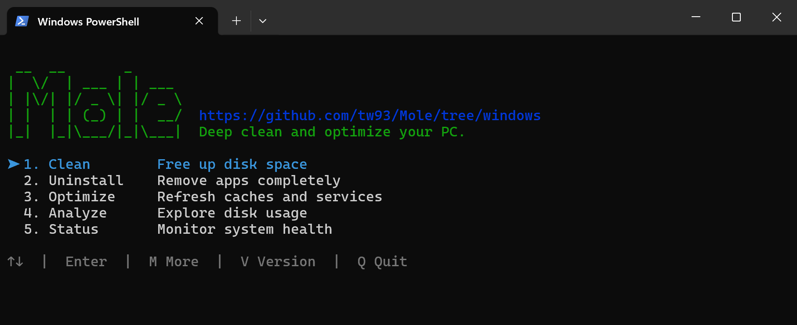
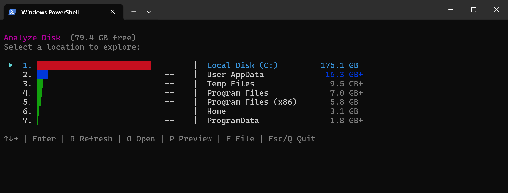
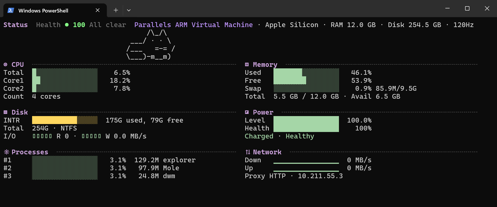

<p align="right"><a href="https://github.com/tw93/Mole">macOS</a> · <b>Windows</b></p>

<div align="center">
  <h1>Mole CLI for Windows</h1>
  <p><b>Tiefenreinigung, App-Deinstallation, Systemoptimierung, Festplattenanalyse und Statusüberwachung für deinen Windows-PC. Kostenloses Open-Source-CLI.</b></p>
    <p><a href="README.md">English</a> · <a href="README_CN.md">中文</a> · <a href="README_TW.md">繁體</a> · <a href="README_JA.md">日本語</a> · <a href="README_KR.md">한국어</a> · Deutsch · <a href="README_FR.md">Français</a> · <a href="README_UA.md">Українська</a> · <a href="README_RU.md">Русский</a></p>
  <a href="https://github.com/tw93/mole/stargazers"></a>
  <a href="https://github.com/tw93/Mole/releases"></a>
  <a href="LICENSE"></a>
  <a href="https://github.com/tw93/mole/commits/windows"></a>
  <a href="https://twitter.com/HiTw93"></a>
  <a href="https://t.me/+9f9gf4ZrFSQ2OWVl"></a>
</div>

<p align="center">
  
</p>

> 💡 Dieser Branch ist das kostenlose Open-Source-Windows-CLI (`mo`). Lieber eine native App? [Mole for Windows](https://mole.fit/de/windows) ist ein separater Download mit Prüfung vor dem Löschen, App-Updates, Autostart-Verwaltung, Festplatten-Drill-down und Live-Status. Das macOS-CLI findest du im [main-Branch](https://github.com/tw93/Mole).

## Funktionen

- **All-in-One CLI-Toolkit**: Vereint Workflows im Stil von CCleaner, IObit Uninstaller, WinDirStat und Task-Manager in einem Terminal-Befehl
- **Tiefenreinigung**: Entfernt temporäre Dateien, Caches, Protokolle und Browser-Reste, um Speicherplatz freizugeben
- **Smarte App-Deinstallation**: Entfernt Apps mitsamt ihren verbliebenen Installationsordnern
- **Festplattenanalyse**: Visualisiert den Speicherplatz mit einer interaktiven TUI und findet große Dateien
- **Systemwartung**: Leert den DNS-Cache, optimiert das Systemlaufwerk und prüft den Zustand der Festplatte
- **Live-Monitoring**: Zeigt CPU, Arbeitsspeicher, Festplatte, Netzwerk und Prozesse in Echtzeit

## Schnellstart

Mole läuft unter Windows 10 und 11 mit dem integrierten Windows PowerShell 5.1. Die Skript-Installation benötigt Git und, wenn sich der Quellcode vom neuesten Release unterscheidet, Go, um die nativen Tools zu bauen. Sie installiert nach `%LOCALAPPDATA%\Programs\mole-cli` und fügt `mo` und `mole` zu deinem PATH hinzu.

**Installation über Scoop**

```powershell
scoop install mole
```

**Oder per Skript**

```powershell
iwr -useb https://raw.githubusercontent.com/tw93/Mole/windows/quick-install.ps1 | iex
```

Mole wird nur über dieses GitHub-Repository, Scoop und [mole.fit](https://mole.fit/de/windows) für die Windows-App verteilt. Websites, die eine „auf Mole basierende“ App anbieten oder dich auffordern, einen kodierten Befehl ins Terminal einzufügen, haben nichts mit Mole zu tun.

**Befehle**

```powershell
mo                           # Interaktives Menü
mo clean                     # Tiefenreinigung
mo uninstall                 # Installierte Apps + deren Reste entfernen
mo optimize                  # Caches & Dienste aktualisieren
mo analyze                   # Visuelle Festplattenanalyse
mo status                    # Live-Dashboard zur Systemgesundheit
mo purge                     # Build-Artefakte von Projekten bereinigen

mo update                    # Mole aktualisieren
mo remove                    # Mole von diesem PC entfernen
mo --help                    # Hilfe anzeigen
mo --version                 # Installierte Version anzeigen
```

**Sichere Vorschau (Dry Run)**

```powershell
mo clean --dry-run
mo uninstall --dry-run
mo optimize --dry-run
mo purge --dry-run
mo history
mo history --json

mo clean --dry-run --debug   # Vorschau + detaillierte Protokolle
mo clean --whitelist         # Geschützte Pfade verwalten
mo clean --system            # Systembereinigung einschließen (als Administrator ausführen)
mo purge --paths             # Projekt-Suchpfade konfigurieren
mo analyze D:\               # Anderes Laufwerk analysieren
```

<details>
<summary><strong>Weitere Installationsoptionen</strong></summary>

Um den Code vor der Installation zu prüfen, klone den Branch `windows` und führe den Installer direkt dort aus. Er behält `.git`, sodass `mo update` später funktioniert:

```powershell
$installDir = "$env:LOCALAPPDATA\Programs\mole-cli"
git clone --branch windows https://github.com/tw93/Mole.git $installDir
powershell -ExecutionPolicy Bypass -File "$installDir\install.ps1" -InstallDir $installDir -AddToPath
```

Füge `-CreateShortcut` für einen Eintrag im Startmenü hinzu. Zum Deinstallieren führe `mo remove` aus.

</details>

## Sicherheit

Mole kann Dateien löschen. Deshalb prüft es Pfade und schützt System- und Profilordner. `uninstall`, `purge` und `remove` fragen vor jedem Entfernen nach einer Bestätigung. Kann Mole nicht belegen, dass eine Änderung sicher ist, überspringt es sie.

- `clean`, `uninstall` und `purge` löschen Dateien, überprüfe sie also zuerst mit `--dry-run` und bei Bedarf mit `--debug`
- `clean` und `purge` löschen endgültig; verifizierte `uninstall`-Reste landen im Papierkorb, der Uninstaller der App behält sein eigenes Verhalten, und in `mo analyze` gelöschte Dateien landen ebenfalls im Papierkorb
- Führe Mole als normaler Benutzer aus; Systemschritte werden übersprungen, sofern PowerShell nicht als Administrator läuft
- Schütze Pfade mit `mo clean --whitelist`
- Bereinigungsaktivitäten werden in `%USERPROFILE%\.config\mole\operations.log` protokolliert; überprüfe sie mit `mo history` oder deaktiviere das Logging mit `MO_NO_OPLOG=1`
- `C:\Windows`, `C:\Program Files`, die Windows-Defender-Ordner und dein Profilstamm werden nie angetastet

Hinweise zum Melden von Schwachstellen und zu den Sicherheitsgrenzen findest du in [SECURITY.md](SECURITY.md).

## Funktionsdetails

Die folgenden Beispiele sind gekürzt. Die genauen Einträge und Größen hängen von deinem PC ab.

### Bereinigung (Clean)

```powershell
mo clean --dry-run
```

```
Clean Your Windows

Dry Run Mode - Preview only, no deletions

⚙ Microsoft Windows 11 Pro | Free space: 100.34GB

➤ User essentials
  → User temp files (>7d old) (109 items, 529.3MB dry)
  → Thumbnail cache (15 items, 11.1MB dry)
  → Memory dumps (10 items, 72.0MB dry)

➤ Browser caches
  → Edge Cache (2 items, 95.0MB dry)
  → Edge Code Cache (2 items, 26.5MB dry)

➤ Developer tools
  → NuGet HTTP cache (1 items, 596.1MB dry)

Dry run complete - no changes made

  Potential space: 1.32GB | Items: 176

  Detailed list: C:\Users\you\.config\mole\clean-list.txt
  Run without --dry-run to apply cleanup
```

Die Detailliste enthält jeden Pfad, den die Vorschau gefunden hat. Kopiere beliebige Pfade daraus in die Whitelist, um sie zu behalten.

### Deinstallation (Uninstall)

```powershell
mo uninstall
```

Listet die installierten Programme aus der Registry und den Windows-Apps nach Größe absteigend auf, entfernt dann die ausgewählten mit ihrem eigenen Deinstallationsprogramm und bereinigt den verbliebenen Installationsordner. `mo uninstall --dry-run` zeigt, welches Deinstallationsprogramm jede App verwenden würde und was entfernt würde, ohne etwas auszuführen.

```text
$ mo uninstall

Select Applications to Uninstall

Use: ↑↓ navigate | Space select | Enter confirm | Q quit | / search

  [✓] VLC media player                              176.4MB
  [✓] Notepad++ (64-bit x64)                         15.2MB
  [ ] 7-Zip 24.08 (x64)                               5.6MB

Selected: 2 apps (191.6MB)
Page 1 of 1

The following applications will be uninstalled:

  • VLC media player (176.4MB)
  • Notepad++ (64-bit x64) (15.2MB)

Continue? (y/N): y

Uninstalling Applications

➤ Uninstalling: VLC media player ✓
  Cleaning leftover files...
➤ Uninstalling: Notepad++ (64-bit x64) ✓

Uninstall Complete
  Successfully uninstalled: 2
```

### Optimierung (Optimize)

```powershell
mo optimize --dry-run
```

```
Optimize and Maintain

 DRY RUN MODE - No changes will be made

⚙ System  6.2/12GB RAM | 154/254GB Disk | Uptime 4.1d

➤ DNS Cache
  → Would flush DNS cache

➤ Disk Health
  ✓ harddisk SSD - Healthy

Dry Run Complete - No Changes Made

  Would apply 1 optimization
  Run without --dry-run to apply changes
```

Schritte wie die Festplattenoptimierung und das Leeren des ARP-Caches benötigen Administratorrechte und werden sonst übersprungen; führe PowerShell als Administrator aus, um sie einzuschließen.

### Speicheranalyse (Analyze)

```powershell
mo analyze
mo analyze D:\
```



Ein interaktiver Festplatten-Explorer mit demselben Aufbau wie die macOS-Version: Mit den Pfeiltasten navigierst du durch Ordner, `Backspace` geht zurück, `T` listet die größten Dateien, und `Del` verschiebt die ausgewählten Objekte nach einer Bestätigung in den Papierkorb.

### Systemstatus (Status)

```powershell
mo status
```



Ein Live-Dashboard mit Zustandswert, CPU, Arbeitsspeicher, Festplatte, Stromversorgung, Netzwerk und den aktivsten Prozessen.

### Projektbereinigung (Purge)

```powershell
mo purge --dry-run
```

Findet Build-Artefakte (`node_modules`, `target`, `build`, `dist`, `venv` und mehr) in deinen Projektordnern und lässt dich auswählen, welche Projekte bereinigt werden; solange du nichts wählst, ist nichts ausgewählt. Die durchsuchten Ordner konfigurierst du mit `mo purge --paths`.

## Community

Vielen Dank an alle Mitwirkenden, die Mole voranbringen. Folge ihnen gern ❤️

<a href="https://github.com/tw93/Mole/graphs/contributors">
  
</a>

## Unterstützung

- Der Kauf von [Mole for Windows](https://mole.fit/de/windows) ist die direkteste Art, die Entwicklung von Mole zu unterstützen
- Wenn dir Mole hilft, gib dem Projekt einen Stern, [teile es auf X](https://twitter.com/intent/tweet?url=https://github.com/tw93/Mole/tree/windows&text=Mole%20-%20Deep%20clean%20and%20optimize%20your%20Windows%20PC.) oder erstelle ein Issue/PR
- Beiträge sind willkommen; lies zuerst [CONTRIBUTING.md](CONTRIBUTING.md)
- Ich habe zwei Katzen, TangYuan und Coke, und wenn Mole dir das Leben ein wenig leichter macht, spendiere ihnen gerne eine Dose <a href="https://cats.tw93.fun?name=Mole" target="_blank">Katzenfutter 🥩</a>

## Lizenz

Mole ist Open Source unter der GPL-3.0; siehe [LICENSE](LICENSE). Modifizierte und weitergegebene Versionen müssen unter derselben Lizenz verbleiben. Bei einem Fork verwende bitte einen eigenständigen Namen und nenne Mole als Upstream-Quelle; siehe [TRADEMARK.md](TRADEMARK.md).
